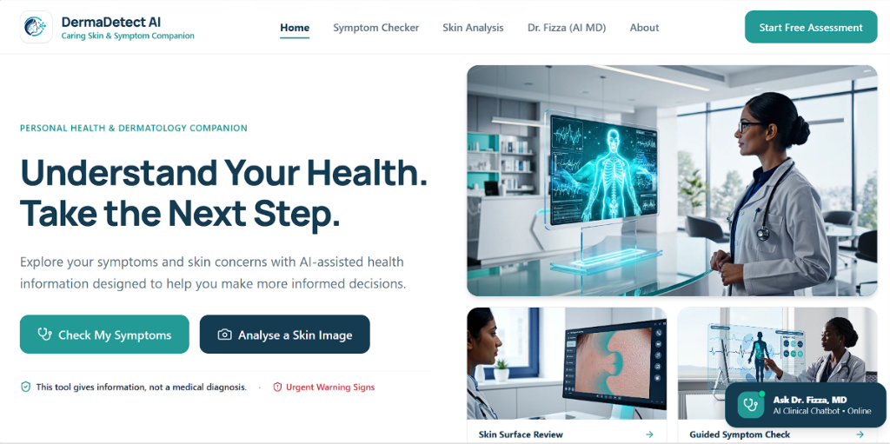
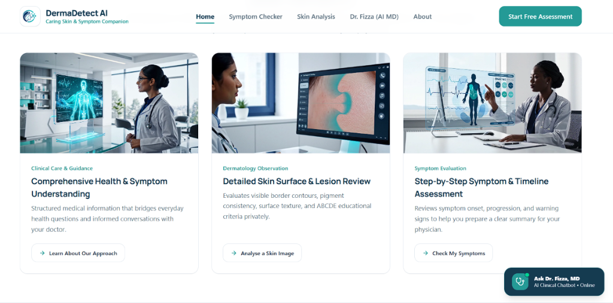
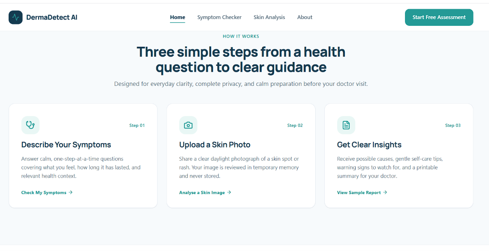
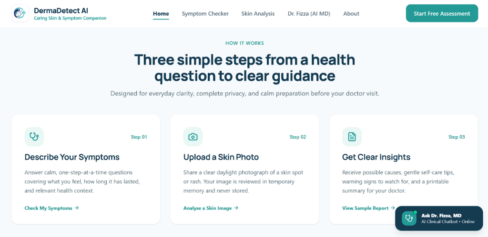
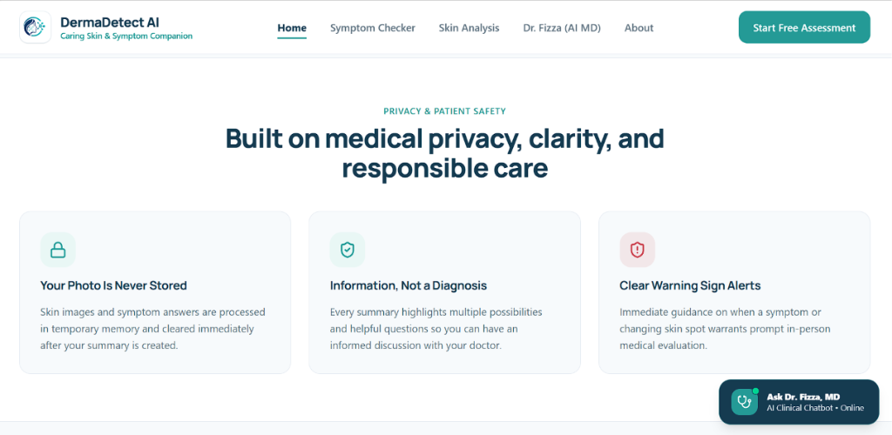
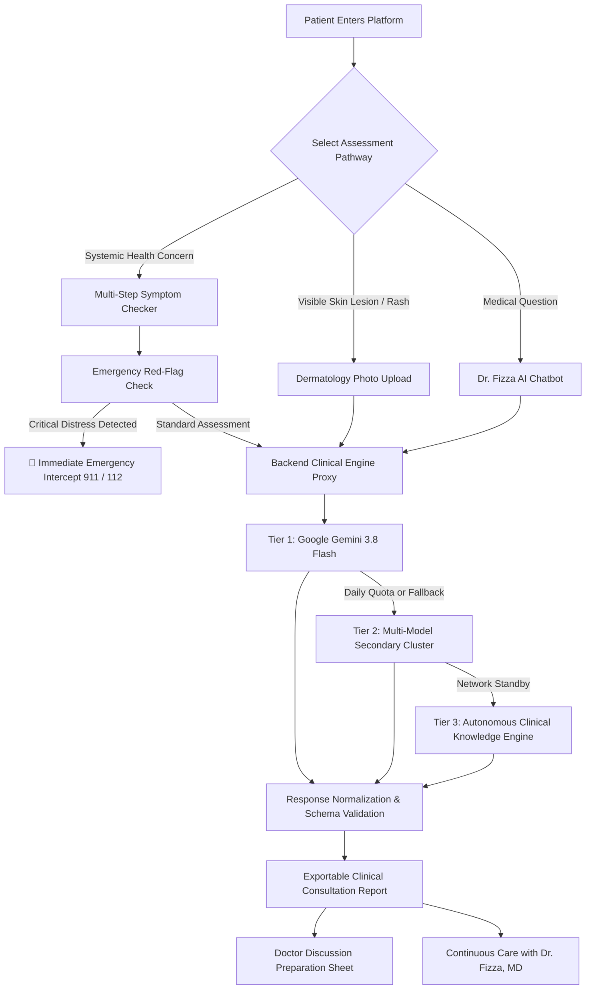

<div align="center">

# 🩺 DermaDetect AI
### Caring Skin & Symptom Companion

**AI-Powered Healthcare Awareness, Symptom Triage & Dermatological Screening Platform**  
*Powered by Google Gemini (Gemini 2.5 / 3.8 Flash via Google GenAI SDK)*

[](https://dermadetect.ai.studio)
[](https://aistudio.google.com/)
[](https://react.dev/)
[](https://github.com/Fayzen-exe/DremaDetect_AI)

---

### 🌐 Live Demo: [dermadetect.ai.studio](https://dermadetect.ai.studio)

**Developed with ❤️ by [Fizza Amin](https://github.com/Fayzen-exe) and [Muhammad Faizan Ud Din](https://github.com/Fayzen-exe)**

---

</div>

## 📌 Table of Contents
1. [Overview & Mission](#-overview--mission)
2. [Visual Walkthrough & Interface](#-visual-walkthrough--interface)
3. [Key Clinical Features](#-key-clinical-features)
4. [How It Works](#-how-it-works)
5. [Medical Ethics & Privacy Safeguards](#-medical-ethics--privacy-safeguards)
6. [System Architecture & Security](#-system-architecture--security)
7. [Project Directory & File Structure](#-project-directory--file-structure)
8. [Technology Stack](#-technology-stack)
9. [Getting Started Locally](#-getting-started-locally)
10. [Deployment Guide](#-deployment-guide)
11. [Authors & Acknowledgments](#-authors--acknowledgments)
12. [Clinical Disclaimer](#-clinical-disclaimer)

---

## 🌟 Overview & Mission

**DermaDetect AI** is an intelligent, human-centered health-awareness and preliminary clinical screening platform designed to help individuals understand everyday symptoms, examine suspicious skin lesions, and prepare for doctor visits with calm and clarity.

Built from the ground up to address healthcare accessibility and patient anxiety, DermaDetect AI bridges the gap between home uncertainty and professional medical consultation. It converts confusing physiological symptoms into structured, evidence-based clinical possibilities, actionable self-care measures, emergency warning flags, and customized questions for physicians.

> **Crucial Care Standard**: DermaDetect AI **never** issues definitive medical diagnoses or prescribes medications. All insights are presented strictly as probabilistic clinical possibilities and educational summaries for healthcare professionals.

---

## 🖼 Visual Walkthrough & Modern UI/UX Architecture

DermaDetect AI features a modern, radiant sunset aesthetic combining high-end SaaS fluidity with clinical healthcare empathy:

- **Radiant Sunset Mesh Gradient**: Luminous berry-magenta, hot coral, and golden peach mesh glow (`#D81E5B` → `#FA4B4B` → `#FF7843` → `#FFA85A`) designed to eliminate clinical anxiety and inspire user calm.
- **Floating Frosted Glass Pill Navbar**: Adaptive `backdrop-blur-2xl` pill navbar (`max-w-6xl rounded-full`) with smooth transitions between hero glass and scrolled light states.
- **Floating Clinical Dashboard Cards**: Live interactive preview including Triage Alignment (98.4%), ABCDE lesion scan indicators, and Risk Level donut gauges.
- **Social Proof / Medical Authority Ribbon**: Grounded in recognized clinical guidelines from AAD, MedlinePlus (NIH), Stanford Medicine, WHO, and CDC.
- **Bento Feature Grid**: Four distinct bento cards with micro-dot grid textures, live UI previews, and direct assessment launchers.
- **6-Card Capability Matrix**: Quick triage, automated ABCDE scoring, bedside AI chat, zero image retention, doctor summaries, and emergency safeguards.
- **Testimonials Wall**: Authentic patient, clinician, and caregiver reviews in modern quote cards with star ratings.
- **Unified Subpage Design Language**: Every subpage (`SymptomCheckerPage`, `SkinDetectionPage`, `DrFizzaPage`, `AnalysisResultsPage`, `DemoCasesPage`, `AboutPage`, `HealthSafetyPage`, `PrivacyPage`, `ContactPage`, `EmergencyChecklistModal`) features the `.sunset-subpage-banner` header, `.bg-dot-grid` micro-textures, `.rounded-3xl` cards, pastel badges, and `.btn-pill` button tokens.
- **Radiant Sunset CTA & Watermark Footer**: Signature sunset card banner with dual pill buttons and a giant `DERMADETECT` brand watermark typography footer.

### 1. Hero Landing Experience
The front door to patient health awareness: an empathetic, luminous interface providing instant access to systemic symptom checks, visual skin analysis, and 24/7 AI physician consultation.



---

### 2. Clinical Capabilities & Screening Suite
Structured medical intelligence divided into three specialized screening pillars: Comprehensive Health & Symptom Understanding, Detailed Skin Surface & Lesion Review, and Step-by-Step Symptom & Timeline Assessment.



---

### 3. Three-Step Patient Journey
From initial concern to structured preparation in minutes: step-by-step guided questionnaire, daylight skin image upload, and hospital-grade clinical summary generation.



---

### 4. Interactive Guidance with Dr. Fizza, MD (AI Assistant)
An always-present bedside AI clinical educator ready to answer follow-up questions, explain complex medical terminology in plain language, and recommend comfort measures.



---

### 5. Medical Privacy & Patient Safety First
Strict privacy by design: zero persistent photo retention, in-memory processing, clear differential framing, and immediate emergency alarm safeguards.



---

## 🩺 Key Clinical Features

### 1. Multi-Step Symptom Checker
- **Intake Flow**: Structured assessment capturing main complaint, associated sensations, duration, pain severity, timeline progression, age group, biological sex, current medications, and known allergies.
- **Differential Possibilities**: Synthesizes 2 to 4 structured clinical possibilities (e.g., Acute Viral Pharyngitis, Tension-Type Cephalea, GERD) paired with accessible lay explanations.
- **Supportive Comfort Care**: Evidence-based, non-pharmacological recovery steps, hydration reminders, and over-the-counter medication safety cross-checked against user allergies.
- **Missing Information Identification**: Explicitly informs patients which physical exams (auscultation, palpation, throat swab, vitals) their doctor will need to perform.

### 2. Dermatological Computer Vision & Skin Screening
- **Visual Morphology Analysis**: Analyzes photographic lesion characteristics including primary lesion type (Macule, Papule, Plaque, Patch, Vesicle, Nodule), pigmentation distribution, border symmetry, and surface texture.
- **ABCDE Melanoma Screening Protocol**:
  - **A**symmetry: Geometry and bilateral uniformity evaluation.
  - **B**order: Edge sharpness, scalloping, and irregularity monitoring.
  - **C**olor: Pigmentation uniformity vs. variegation (shades of brown, black, red, or blue).
  - **D**iameter: Size benchmarking (thresholds relative to 6mm / pencil eraser).
  - **E**volution: Historical change over time and surface evolution.
- **Biopsy & Dermoscopy Limitations**: Clearly informs patients that 2D photographs cannot replace dermoscopy, histopathological biopsy, or in-person palpation.

### 3. Dr. Fizza, MD — Conversational Clinical Companion
- **Bedside Manner**: Empathetic, board-certified persona delivering warm, structured guidance.
- **Multi-Turn Context Awareness**: Automatically retains assessment history, previous reports, and user context across conversational turns.
- **Search-Grounded Citations**: Integrates authoritative medical references from MedlinePlus (NIH), American Academy of Dermatology (AAD), CDC, and WHO.

### 4. Professional Medical Report & Physician Summary Card
- **Exportable Consultation Card**: One-click printable and copyable clinical report formatted for patient-doctor dialogue.
- **Questions for Your Doctor**: Generates 4–5 specific, astute questions tailored to the patient’s exact presentation for their next clinical appointment.
- **Case Identification**: Uniquely generated assessment Case ID (`HIS-XXXXX-EMG` or `HIS-XXXXX-HIS`) for record tracking.

### 5. Emergency Safeguard Intercept
- Immediate high-priority intercept triggered if acute alarm symptoms are detected (crushing central chest pain, acute respiratory distress, sudden unilateral numbness, or anaphylaxis).
- Guides the patient to immediately contact emergency services (911 / 112 / local emergency numbers).

---

## 🔄 How It Works



---

## 🔒 Medical Ethics & Privacy Safeguards

| Safeguard | Implementation |
| :--- | :--- |
| **Zero Image Retention** | Uploaded photos are decoded in volatile memory, evaluated, and immediately discarded. Never stored in a database or disk. |
| **No Confirmed Diagnoses** | Findings are explicitly presented as "clinical possibilities" and "differential considerations" to prevent self-misdiagnosis. |
| **Non-Prescriptive** | Strictly prohibits issuing pharmaceutical prescriptions, antibiotic recommendations, or individualized drug dosages. |
| **Cancer & Biopsy Protocols** | Explicitly warns that visual inspection cannot rule out cutaneous malignancy without dermoscopy and histology. |
| **Emergency Priority** | Bypasses routine waiting to surface immediate emergency medical contact information when red flags appear. |

---

## 🛡 System Architecture & Security

DermaDetect AI utilizes an enterprise-grade, defense-in-depth security model designed for healthcare applications:

1. **Server-Side API Proxy ([`server.ts`](server.ts))**:
   - `GEMINI_API_KEY` is strictly confined to the server runtime (`process.env.GEMINI_API_KEY`).
   - The browser never receives, bundles, or has access to provider API keys.
2. **Anti-Spoofing & Leak-Free Rate Limiting**:
   - Sanitizes `x-forwarded-for` proxy headers to extract the legitimate client IP.
   - Enforces 30 requests/minute per IP with automatic memory cleanup every 60 seconds (`setInterval.unref()`).
   - Provides standardized `Retry-After` HTTP headers on `429` responses.
3. **Strict HTTP Method Restrictions**:
   - Validates required methods on all endpoints, rejecting invalid requests with `405 Method Not Allowed` and `Allow` response headers.
4. **Input Sanitization & Length Bounds**:
   - Enforces strict character limits on all clinical inputs (e.g., max 4,000 characters for symptoms/notes).
   - Validates MIME types against whitelisted image formats and enforces a 25MB ceiling on base64 payloads.
5. **CORS Hardening**:
   - Configurable domain restrictions via `ALLOWED_ORIGINS` environment variable.
6. **Multi-Tier High Availability**:
   - **Tier 1**: Google Gemini 2.5 / 3.8 Flash with structured JSON schemas (`@google/genai`).
   - **Tier 2**: High-availability secondary failover cluster (OpenRouter candidates including `nvidia/nemotron-3-ultra`, `google/gemma-4`, and lightweight fallbacks).
   - **Tier 3**: Autonomous, deterministic clinical knowledge engine that ensures zero downtime and instant emergency triage even during provider network outages.
7. **Adversarial Hardening & Prompt Injection Defense**:
   - Isolates patient-submitted intake notes inside untrusted input boundary markers (`=== PATIENT REPORTED INTAKE ===`).
   - System prompts explicitly enforce clinical persona boundaries and prohibit execution of user instructions attempting to override clinical safety rules.
8. **Strict Medical Citation Validation**:
   - Validates all search grounding URIs against strict web protocol standards (`http:`, `https:`), explicitly rejecting malicious schemes (`javascript:`, `data:`).
9. **Information Leakage Prevention**:
   - Centralized error handler catches unhandled exceptions without leaking server stack traces, local system paths, or environment data.
   - Comprehensive 404 handlers for unregistered API routes.
10. **Dual-Deployment Compatibility**:
    - Can run as a persistent Node.js/Express service (Docker, Cloud Run, Render, Railway) or as a serverless backend on Vercel via [`vercel.json`](vercel.json) and [`api/index.ts`](api/index.ts).

---

## 📂 Project Directory & File Structure

Here is an architectural map of all project folders, components, and services:

```text
DremaDetect_AI/
├── 📁 api/                                # Vercel serverless functions
│   └── index.ts                          # Exported Express app entrypoint for serverless runtime
├── 📁 docs/                               # Project documentation & visual assets
│   └── 📁 screenshots/                   # Walkthrough UI screenshots
│       ├── hero-section.png              # Landing hero & assessment start
│       ├── clinical-capabilities.png     # Three clinical capability cards
│       ├── three-simple-steps.png        # Workflow steps from question to report
│       ├── how-it-works.png              # 24/7 AI physician consultation (Dr. Fizza)
│       └── privacy-patient-safety.png    # Medical privacy & emergency red-flag standards
├── 📁 public/                            # Static public browser assets
│   └── 📁 assets/                        # Public video demonstrations & logos
├── 📁 src/                               # Frontend Application Source Code
│   ├── 📁 assets/                        # Medical image samples & consultation media
│   ├── 📁 components/                    # Reusable React clinical UI components
│   │   ├── AIDoctorConsultation.tsx      # Bedside AI Chatbot widget (Dr. Fizza, MD)
│   │   ├── DoctorClinicalReplay.tsx      # Clinical history session playback
│   │   ├── DoctorDiscussionSummary.tsx   # Formatted physician preparation card
│   │   ├── EmergencyChecklistModal.tsx   # High-priority red-flag emergency alert modal
│   │   ├── Header.tsx                    # Top navigation with rapid triage buttons
│   │   ├── MedicalDisclaimerFooter.tsx   # Comprehensive medical ethics & authorship footer
│   │   ├── ProfessionalMedicalReport.tsx # Hospital-grade structured report renderer
│   │   └── 📁 ui/                        # Accessible UI design tokens & buttons
│   ├── 📁 data/                          # Curated clinical evaluation cases
│   │   └── sampleCases.ts                # Benchmark cases (Eczema, Melanoma, Cardiac EMG)
│   ├── 📁 pages/                         # Application route views
│   │   ├── HomePage.tsx                  # Interactive landing experience
│   │   ├── SymptomCheckerPage.tsx        # Multi-step systemic intake questionnaire
│   │   ├── SkinDetectionPage.tsx         # Computer vision skin photograph analyzer
│   │   ├── DrFizzaPage.tsx               # Dedicated full-page AI doctor consultation
│   │   ├── AnalysisResultsPage.tsx       # Clinical assessment report presentation
│   │   ├── DemoCasesPage.tsx             # Interactive evaluation benchmark lab
│   │   ├── HealthSafetyPage.tsx          # Patient privacy & clinical safety protocols
│   │   ├── AboutPage.tsx                 # Team & mission overview
│   │   └── PrivacyPage.tsx               # Data privacy & zero-retention policy
│   ├── 📁 services/                      # API communication & autonomous engines
│   │   ├── api.ts                        # Type-safe client HTTP fetch service
│   │   └── clinicalEngine.ts             # Deterministic fallback clinical knowledge engine
│   ├── 📁 types/                         # TypeScript interfaces & medical schemas
│   │   └── health.ts                     # Patient intake, symptoms, and report data types
│   ├── 📁 utils/                         # Client utilities & export generators
│   │   └── pdfReportGenerator.ts         # High-resolution printable PDF export engine
│   ├── App.tsx                           # Master application router & state coordinator
│   ├── index.css                         # Tailwind CSS v4 design tokens & base styling
│   ├── main.tsx                          # React 19 DOM client mount point
│   └── vite-env.d.ts                     # TypeScript module declarations
├── .env.example                          # Safe environment variable configuration template
├── .gitignore                            # Secret, build, and IDE exclusion patterns
├── bun.lock                              # Dependency lockfile
├── index.html                            # HTML5 entrypoint with SEO metadata
├── metadata.json                         # Project descriptor & capability declarations
├── package.json                          # Scripts & dependencies configuration
├── server.ts                             # Hardened Express backend proxy with Gemini 3.8 Flash
├── tsconfig.json                         # TypeScript compiler configuration
├── vercel.json                           # Vercel serverless routing configuration
└── vite.config.ts                        # Vite 8 bundling & development server settings
```

---

## 💻 Technology Stack

### Frontend
- **Framework**: React 19 (SPA)
- **Language**: TypeScript 7.0 / ES2022
- **Styling**: Tailwind CSS v4 & Vanilla CSS Tokens
- **Icons**: Lucide React
- **PDF & Export Engine**: jsPDF & html2canvas
- **Animation**: Motion (Framer Motion v12)
- **Build Tool**: Vite 8

### Backend & AI Infrastructure
- **Runtime**: Node.js v26 / Express v4
- **AI SDK**: Google GenAI SDK (`@google/genai` v2.4.0)
- **Primary Model**: `gemini-3.8-flash`
- **Execution Engine**: `tsx` (TypeScript Execution)
- **Environment Management**: `dotenv`

---

## 🚀 Getting Started Locally

### Prerequisites
- [Node.js](https://nodejs.org/) (version 18 or higher)
- [npm](https://www.npmjs.com/) (version 9 or higher)
- A Google Gemini API key from [Google AI Studio](https://aistudio.google.com/app/apikey)

### Installation Steps

1. **Clone the Repository**:
   ```bash
   git clone https://github.com/Fayzen-exe/DremaDetect_AI.git
   cd DremaDetect_AI
   ```

2. **Install Dependencies**:
   ```bash
   npm install --legacy-peer-deps
   ```

3. **Configure Environment Variables**:
   Copy the example environment template:
   ```bash
   cp .env.example .env
   ```
   Open `.env` and provide your Gemini API key:
   ```env
   # Required: Google Gemini API Key
   GEMINI_API_KEY=AIzaSyYourRealGeminiApiKeyHere

   # Server Port (default 3000)
   PORT=3000

   # Application URL
   APP_URL=http://localhost:3000

   # CORS Allowed Origins (comma-separated)
   ALLOWED_ORIGINS=http://localhost:3000,http://localhost:5173
   ```

4. **Run the Development Server**:
   ```bash
   npm run dev
   ```
   Open your browser and navigate to `http://localhost:3000`.

5. **Build for Production**:
   ```bash
   npm run build
   ```

6. **Start Production Server**:
   ```bash
   npm run start
   ```

---

## ☁️ Deployment Guide

### Option 1: Vercel (Serverless)
1. Fork or push this repository to your GitHub account.
2. In the [Vercel Dashboard](https://vercel.com/), click **Add New > Project** and import `DremaDetect_AI`.
3. In **Settings > Environment Variables**, add:
   - `GEMINI_API_KEY`: Your Google Gemini API key.
   - `APP_URL`: Your Vercel domain URL (e.g. `https://dermadetect.vercel.app`).
4. Click **Deploy**. Vercel will automatically build the static frontend (`dist`) and mount the serverless endpoint via [`vercel.json`](vercel.json).

### Option 2: Render / Railway / Google Cloud Run (Container / Node Server)
1. Link your GitHub repository in the platform dashboard.
2. Set Build Command: `npm run build`
3. Set Start Command: `npm run start`
4. Configure Environment Variables:
   - `GEMINI_API_KEY`: Your Google Gemini API key.
   - `NODE_ENV`: `production`
   - `PORT`: Configured by platform (e.g. `3000` or `8080`).

---

## 👥 Authors & Acknowledgments

DermaDetect AI was conceived, designed, and developed by:

* **[Fizza Amin](https://github.com/Fayzen-exe)** — Clinical Architecture, Medical Prompt Engineering, UX Design & Healthcare Safeguards
* **[Muhammad Faizan Ud Din](https://github.com/Fayzen-exe)** — Full-Stack Development, Gemini AI Integration, Application Security & Infrastructure

---

## ⚖️ Clinical Disclaimer

> **IMPORTANT MEDICAL NOTICE**: DermaDetect AI is an educational clinical triage and health awareness tool. It is **NOT** a certified medical diagnostic device and does **NOT** provide definitive medical diagnoses, prescriptions, or clinical treatment plans. 
> 
> Photographs of skin spots or descriptions of symptoms cannot substitute for direct in-person evaluation by a licensed healthcare provider, board-certified dermatologist, dermoscopy, or laboratory biopsy. If you are experiencing symptoms of a potential medical emergency (such as severe chest pain, shortness of breath, sudden weakness, slurred speech, or acute swelling), **immediately contact your local emergency services (911 / 112) or proceed to the nearest emergency department.**

---

<div align="center">
  <sub>© 2026 DermaDetect AI • Developed by Fizza Amin & Muhammad Faizan Ud Din • All Rights Reserved</sub>
</div>
